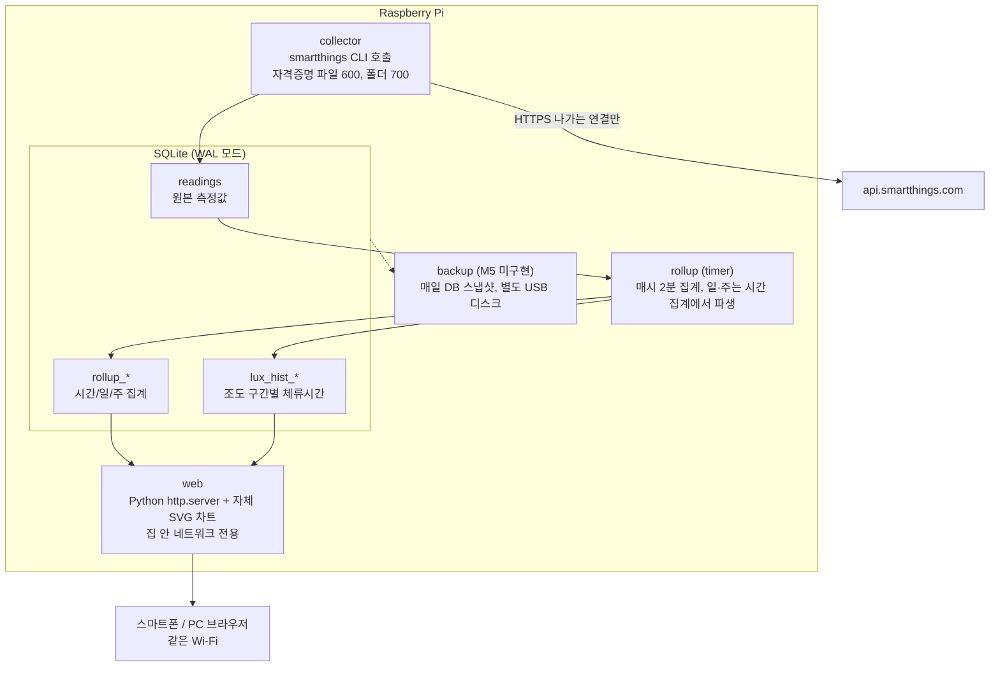

# SmartThings 센서 데이터 수집·분석 시스템 — 계획서

- 작성일: 2026-11-08
- 개정: 2026-11-10 (SmartThings CLI 수집 방식 반영, 구현과 대조, 배포 후 상태 반영)
- 범위: 왜 이렇게 정했는지와 진행 단계
- 지금 코드의 동작, 테이블, 서비스: [docs/ARCHITECTURE.md](docs/ARCHITECTURE.md)가 기준
- 문서 전체 안내: [docs/README.md](docs/README.md)

---

## 1. 목표

- SmartThings 앱에서 볼 수 없는 장기 추세와 분포를 직접 수집해 분석

| 대상 | 보고 싶은 것 |
|---|---|
| 온습도 센서 4기 (방별) | 평균 / 최대 / 최소 — 시간별(24시간), 일별(1개월), 주별(1년) |
| 조도 센서 4기 | 위와 같은 통계 + **많이 측정된 조도 구간을 색으로 강조**(히트맵·히스토그램) |
| 재실 센서 2기 | 시간대·요일별 재실 패턴 |
| 스마트플러그 10기 | 켜짐/꺼짐 이력, 전력·에너지(측정 지원 모델만) |

- 기존 SmartThings 자동화(재실 + 조도 → 보조등): 그대로 유지
- 이 시스템의 역할: 관찰만 수행, 기기 제어 없음 (§2 원칙 3)

## 2. 원칙과 제약

1. **데이터 경로는 SmartThings ↔ 내 RPi 둘뿐**
   - Home Assistant, 클라우드 DB, 외부 대시보드 같은 중간 플랫폼 미사용
2. **외부에서 들어오는 연결 0개**
   - 웹훅(실시간 수신) 미사용, 폴링(주기적 조회)만 사용
   - 공유기 포트포워딩 없음
3. **자격증명 권한이 읽기 전용이 아니므로 코드와 파일 권한으로 제한**
   - CLI 로그인 자격증명의 권한: `controller:stCli`, 기기 제어까지 가능
   - 수집기 코드의 명령 허용 목록으로 읽기 명령만 실행
   - 수집기 안의 제한이라 자격증명 파일 유출 시 차단 불가
   - 파일 보호: `stcollector` 계정 전용(파일 600, 폴더 700)
   - 유료 OAuth 방식(§5)을 쓸 때만 권한 자체를 읽기(`r:devices:*`, `r:locations:*`)로 축소 가능
4. **모든 것을 로컬에서 처리**
   - 저장, 집계, 대시보드, 백업 전부 RPi 안에서 수행
   - Google Drive 등 외부 백업 미사용
5. **대시보드는 외부 자원을 불러오지 않음**
   - 자체 SVG 차트 코드를 RPi에 같이 배치, CDN 미사용
   - 집 안 네트워크에서만 접속

## 3. 하드웨어 · OS

| 항목 | 권장 |
|---|---|
| 본체 | **Raspberry Pi 3 B+ (RAM 1GB) — 확보함.** 수집기 용도로 충분. 대시보드 체감 속도는 M3에서 실측 |
| 저장장치 | **microSD 32GB — 확보함.** 용량은 충분(원본 최악 연 1GB), 쓰기 수명과 정전 손상이 약점. 고내구성(High Endurance) 카드 권장, journald 용량 제한으로 보완, USB 메모리 자동 백업은 M5에서 구현 예정(미구현) |
| 전원 | 5V 2.5A 이상 정격 어댑터. 전압 부족 시 SD카드 손상 위험 증가. 시험 결과는 [docs/POWER_TEST.md](docs/POWER_TEST.md) |
| 운영 설정 | Bluetooth·Wi-Fi 끔(`dtoverlay=disable-bt`, `dtoverlay=disable-wifi`), `arm_freq=900`, `maxcpus=1`. DZ5V3A, QC5V(25cm 케이블), QC5V(15cm 케이블)로 각각 약 12분 시험한 결과이므로 다른 어댑터나 케이블에 그대로 적용 불가. 전압 상태는 운영 중에 `vcgencmd get_throttled`로 확인 |
| 접속 | 모니터·키보드 없이 이더넷 + SSH로 운영 ([README M0](README.md#m0-준비)) |
| 백업 디스크 | 별도 USB 메모리나 SSD 1개 (본체 디스크와 분리). 자동 백업은 M5 미구현 |
| OS | Raspberry Pi OS Lite 64-bit (화면 없이 운영). 현재 RPi는 Debian 13, Python 3.13 |
| 시간 | NTP 동기화, 시간대 `Asia/Seoul` (DB에는 UTC로 저장, 화면에만 KST로 표시) |
| 선택 | 소형 UPS — 정전 시 DB 손상 방지 |

## 4. 전체 구조

- 언어: Python 3.11+
- 의존성
  - 수집기, 집계, 웹서버의 Python 코드: 표준 라이브러리만 사용 (RPi 3 B+의 메모리와 공급망 위험을 줄이기 위한 결정)
  - Python 외 실행 의존성: SmartThings CLI 하나(3.0.0, linux-arm64 단일 실행 파일), 수집기만 호출
  - CLI 호출 1회: RSS 최대 약 156MB, 약 6초 (900MHz, 1코어 측정)
- 서비스 관리: systemd
  - collector, web, sysmon: 상시 실행
  - rollup: timer로 주기 실행
  - backup: M5에서 추가 예정
  - 유닛 관계: [ARCHITECTURE](docs/ARCHITECTURE.md#서비스와-타이머) 참고

## 5. 인증 (SmartThings CLI 로그인)

### 5.1 배경

- 2024년 12월 말 이후 발급한 개인 토큰(PAT): 24시간 후 만료되어 상시 수집에 사용 불가
- OAuth-In 앱 생성·관리: 유료 Developer Plan(보도상 월 $4.99, 2026-11-04 시작) 필요
- 결정: 비용을 들이지 않기 위해 RPi에서 SmartThings CLI에 로그인하고 수집기가 CLI를 호출

### 5.2 절차 (최초 1회)

1. CLI를 `/opt/stcollector-cli/smartthings`(root 소유, 서비스 계정은 실행만)에 설치
2. SSH 터널과 PC 브라우저로 로그인 ([README: CLI 로그인과 재로그인](README.md#cli-로그인과-재로그인))
3. 자격증명을 서비스 계정의 `/var/lib/stcollector/cli/.local/share/@smartthings/cli/credentials.json`에 배치. 파일 `600`, 폴더 `700`. 다른 계정으로 로그인했다면 `deploy/migrate-cli-credentials.sh`로 이전

### 5.3 운영 중

- 수집기: `HOME`을 `cli_home`으로 지정해 CLI를 실행, 명령 허용 목록에 있는 읽기 명령만 호출 (§2 원칙 3)
- `MemoryDenyWriteExecute`: CLI가 Node 기반이라 V8 JIT 때문에 `stcollector.service`에서만 해제, `stcollector-web`, `stcollector-rollup`은 유지
- 샌드박스 안 CLI 동작: 2026-11-10 RPi에서 위 설정으로 확인 (기기 25개, 수집 방식 `history`)
- RPi 미확인: CLI 액세스 토큰 자동 갱신 여부(액세스 토큰 만료 2026-11-10T15:06Z, 2026-11-11 00:06 KST), 리프레시 토큰의 유효기간, 만료 시 재인증 출력
- 인증 실패 시: 대시보드 상태 페이지에 '재인증 필요' 경고 표시, [README 절차](README.md#cli-로그인과-재로그인)로 재로그인

### 5.4 선택지: OAuth (유료 Developer Plan 필요)

- 앱 생성: `smartthings smartapps:create`로 API_ONLY 타입 앱 생성(CLI 3.0.0에서 `apps*`가 `smartapps*`로 변경), `backend = "oauth"`로 설정
- 권한: `r:devices:*`, `r:locations:*`만 수신
- 토큰: `/var/lib/stcollector/token.json`(600)에 저장, 만료 전 자동 갱신, 임시 파일에 쓴 뒤 교체
- client secret: `config.toml`(640, root:stcollector)에만 저장

## 6. 수집 (collector)

### 6.1 데이터 촘촘함은 센서 보고 주기가 정한다

- **폴링을 센서 보고 주기보다 자주 돌려도 새 데이터는 생기지 않음**
  - API는 클라우드에 저장된 마지막 보고값만 반환
  - 보고 사이에 조회하면 같은 값과 같은 보고 시각이 반복
- 대부분의 Zigbee/Z-Wave 센서: 값이 일정 이상 변하면 보고, 변화가 없어도 최대 N분마다 한 번 보고 (아래는 일반적 예시, 기기마다 다름)
  - 온습도: 0.1~0.5°C 또는 1~5%RH 변화 시, 혹은 최대 30~60분마다
  - 조도: 일정 비율 이상 변화 시, 혹은 수 분~1시간마다
  - 재실: 감지는 즉시, 해제는 수십 초~수 분의 대기 후
- 더 촘촘하게 받는 유일한 방법: 센서 설정 변경
  - SmartThings 앱의 기기 설정에서 드라이버(Edge)가 '보고 주기'나 '민감도' 항목을 제공하면 조정 가능
  - 대가: 배터리 소모 증가
  - 항목이 없으면 펌웨어에 고정되어 변경 불가
- 지연: 센서 → 허브 → 클라우드 → API를 거치므로 몇 초 정도는 불가피
- M1에서 1주일 수집하면서 센서별 실제 보고 간격 측정, 그 결과로 수집 주기와 센서 설정 조정 여부 결정

### 6.2 수집 방식: 이벤트 이력을 우선, 상태 조회는 대안

| 방식 | 받는 것 | 약점 |
|---|---|---|
| 상태 조회 (`/status`) | 각 속성의 **마지막 값 하나** | 폴링 사이에 보고가 2번 이상 오면 중간 값 유실. 짧은 재실 변화 누락 |
| **이벤트 이력 조회** | 기기가 보고한 이벤트를 **시간순으로 전부** | 공식 문서화 수준과 보관 기간 확인 필요 (§12-5) |

- 이벤트 이력 사용 가능 시 주 방식으로 채택
  - N분마다 "마지막으로 받은 이벤트 이후"를 조회해 보고 누락 없음
  - 폴링 주기(예: 5분)는 대시보드에 반영되기까지의 지연만 결정, 데이터의 촘촘함에는 영향 없음
  - 요청 수 감소
- 사용 불가 시 상태 조회로 대체
  - 주기: §6.1에서 측정한 센서별 실제 보고 간격에 맞춤
  - 그보다 짧은 주기는 무의미

### 6.3 API와 수집 대상

#### 사용 API

- `GET /devices` — 기기 목록, 방(room) 정보, 지원 기능 확인. 시작할 때 1회 + 하루 1회 갱신
- `GET /devices/{deviceId}/status` — 현재 상태. 속성마다 값과 **센서가 실제로 보고한 시각**(`timestamp`) 포함
- 이벤트 이력 조회 API — 기기별 보고 이벤트 목록 (경로와 응답 형식은 §12-5에서 확인)
- CLI 방식: 같은 데이터를 CLI의 `--json` 출력으로 수신. 예: `devices --json`, `locations:history <위치> --json --limit 200 --after <시각>`
- RPi에서 위치 단위 이력 1회 호출: 약 6초

#### 수집 대상 속성

| 기능(capability) | 속성 | 상태 조회 방식일 때 초기 주기 (M1 측정 후 조정) |
|---|---|---|
| `temperatureMeasurement` | `temperature` | 5분 |
| `relativeHumidityMeasurement` | `humidity` | 5분 |
| `illuminanceMeasurement` | `illuminance` | 1분 |
| `motionSensor` / `presenceSensor` | `motion` / `presence` | 30초~1분 |
| `switch` | `switch` | 1분 |
| `powerMeter`, `energyMeter` | `power`, `energy` | 1분 / 15분 |
| `battery` | `battery` | 6시간 |

- 주기: `config.toml`에서 기능별로 변경 가능. 표의 주기는 OAuth 방식 기준
- CLI 방식의 상태 조회: CLI 비용이 커서 `devices --status` 1회로 전 기기를 읽고 `history_interval_s`(기본 300초)보다 자주 읽지 않음
- 중복 제거: (기기, 컴포넌트, capability, 속성, 보고 시각)이 같으면 저장 안 함. 값이 그대로면 새 행 없음
- 요청량 (OAuth 상태 조회 기준): 최대 약 24~40건/분. SmartThings 요청 한도 안으로 예상, §12에서 확인
- 429(요청 과다) 응답: OAuth 방식은 대기 시간을 늘려 가며 재시도, CLI 방식은 30초 뒤 1회 재시도
- 한계: 상태 조회 방식에서는 폴링 사이의 짧은 재실 변화를 놓칠 수 있음(§6.2). 이벤트 이력 방식이면 문제 없음
- 네트워크 단절: 재연결 뒤 이어서 수집, 기록 공백은 상태 페이지에 표시

## 7. 저장 · 집계

### 7.1 테이블

- 테이블 목록과 역할: [ARCHITECTURE: DB 테이블](docs/ARCHITECTURE.md#db-테이블)이 기준
- 컬럼 정의: `stcollector/schema.sql`이 기준
- 설계 결정
  - 원본(`readings`)과 시간·일·주 집계를 분리해 차트의 원본 스캔 방지
  - 원본의 기본 키에 보고 시각을 넣어 DB가 중복 제거
  - 시각은 UTC epoch 밀리초로 저장
  - `readings` 삽입 트리거가 바뀐 시간대를 표시해 집계가 그 구간만 재계산

### 7.2 집계 규칙

- 시간 가중 평균 사용
  - 센서는 값이 변할 때 위주로 보고하므로, 측정 건수로 단순 평균을 내면 변화가 잦은 구간이 과대 반영
  - 각 값은 다음 보고가 올 때까지 유지된 것으로 간주
- min/max: 해당 구간에 유효했던 실제 보고값 기준. 구간 시작 시점에 유지되던 이전 보고값도 포함하므로 항상 min ≤ avg ≤ max
- 다음 보고가 없을 때: 값은 `max_hold_s`(속성별, 기본 2시간, 에너지 6시간, 재실 7일, 스위치 1년)까지만 유지로 간주
- `coverage`(0~1): 구간 중 데이터가 있었던 비율. 수집이 끊긴 구간을 차트에서 흐리게 표시하는 데 사용
- 일·주 단위의 날짜 경계: KST 기준
- 재계산: 같은 구간을 다시 계산해도 결과 동일. 늦게 들어온 데이터나 재실행에 안전
- 집계 범위: 끝난 시간까지만(매시 2분). `readings` 삽입 트리거가 바뀐 시간대를 표시해 그 구간만 재계산, 일·주는 시간 집계에서 파생

### 7.3 조도 구간 (로그 스케일)

`0–1 · 1–5 · 5–10 · 10–25 · 25–50 · 50–100 · 100–200 · 200–500 · 500–1k · 1k–2k · 2k–5k · 5k–10k · 10k+ lx`

- 구간 설계: 사람 눈은 밝기를 로그 스케일로 인식, 실내 조도는 대부분 0~500 lx에 분포하므로 낮은 구간을 촘촘하게 분할
- 집계 단위: 측정 건수가 아니라 그 구간에 머문 시간(초). "어떤 밝기 대역이 오래 지속됐는지"를 정확히 확인하기 위함

### 7.4 보관과 용량

- 원본(`readings`)
  - 기본 1년 보관 후 삭제(설정 가능)
  - 항목별 최신 보고 1건은 현재 상태를 위해 유지
  - 최악의 경우 연 1GB 이하 예상, 중복 제거 후에는 훨씬 적음
- 집계 테이블: 무기한 보관 (연 수 MB 수준)

## 8. 대시보드 (web)

### 8.1 서버: RPi가 직접 제공한다

- 대시보드 서버도 같은 RPi에서 실행
  - 별도 서버나 클라우드 호스팅 없음
  - 수집기, DB, 웹서버가 한 기기 안에 위치
- 서버 구성
  - Python 표준 라이브러리 HTTP 서버가 JSON API와 정적 페이지를 함께 제공
  - FastAPI와 ECharts(약 1MB) 대신 전용 SVG 차트(`web/static/charts.js`, 약 17KB)를 프로젝트에 포함
  - 외부 라이브러리와 외부 요청 없음
- 성능
  - 차트는 미리 계산된 집계 테이블에서 그리므로 RPi 3 B+에서도 동작 예상
  - 조건: 원본 데이터를 훑는 화면을 만들지 않음
  - 실제 응답 시간: M3에서 측정
- 접속 주소 예: `http://<RPi IP>:8080` 또는 `http://homesensor.local:8080`(mDNS, 방화벽 적용 후 동작은 RPi 미확인)
- 공유기에서 RPi에 고정 IP 할당
- 스마트폰: 브라우저의 '홈 화면에 추가'로 앱처럼 사용 가능
- 집 밖에서 접속: 기본 미지원. 필요해지면 포트포워딩 대신 공유기 자체 VPN(WireGuard 등)으로 집 안 네트워크에 들어오는 방식만 사용, 외부 중계 서비스 미사용
- HTTPS: 집 안 네트워크에서 비밀번호를 쓰므로 자체 서명 인증서로 적용 가능(선택, 미구현). 지금은 HTTP만 제공

### 8.2 화면 구성

- 모바일 우선 반응형, 라이트/다크 모드
- 접근 제어
  - 집 안 네트워크 대역에서만 허용(방화벽 + 앱의 `allowed_networks` + systemd `IPAddressAllow`)
  - 로그인 비밀번호 1개(scrypt 해시로 설정 파일에 저장, 세션 쿠키)
  - 비밀번호 미설정 시 웹서버 시작 거부

| 화면 | 내용 |
|---|---|
| **요약** | 방별 현재값 띠(온도 크게, 습도·조도·재실), 최근 24시간 온도 큰 차트 1개, 습도·조도 작은 차트 2개, 방별 상태 표(재실, 이슬점, 오늘 최대/최소) |
| **추세** (온도·습도·조도·이슬점 전환) | 기간 전환: 24시간(시간별) / 1개월(일별) / 1년(주별). 평균선 + 최대~최소 범위 띠. 방별 겹쳐 보기. 조도는 로그 눈금 |
| **조도 분포** ★ | ① 히트맵: 가로 날짜 × 세로 시각(0~23시), 색 = 평균 lux ② 히트맵: 세로 조도 구간 × 가로 시각, 색 = 체류시간 (스마트폰 폭에 맞춰 시안대로 축 방향 변경) → **어느 시간대에 어떤 밝기가 많은지** 한눈에 ③ 히스토그램: 가장 많이 측정된 구간을 강조색으로, 누적 80% 범위 표시 조도 화면의 색: 전구색 계열 |
| **재실 패턴** | 요일 × 시각 재실 비율 히트맵. 재실 중 조도 분포(보조등 기준값 조정용) |
| **플러그** | 켜짐 시간, 전력·에너지 일/월 합계(지원 모델만) |
| **시스템 상태** | RPi 온도·클럭·load·메모리, 전압 부족·과열 이벤트와 직전 60초 프로세스, 마지막 수집 시각, 센서별 마지막 보고 시각, 배터리, 토큰 상태, 수집 공백, 디스크 사용량 |

## 9. 운영 · 보안

### 9.1 RPi 기본 보안 설정

- SSH: 키 인증만 허용, 비밀번호 로그인 끔, 기본 계정 미사용
- 방화벽(`ufw`): 집 안 네트워크 대역에서 SSH와 대시보드 포트만 허용, 나머지 모두 차단
- 보안 업데이트: 자동 적용(`unattended-upgrades`)
- 서비스: 전용 계정 `stcollector`(로그인 불가)로 실행, systemd 보안 옵션(`ProtectSystem`, `NoNewPrivileges` 등) 적용

### 9.2 위협과 대응

| 위협 | 대응 |
|---|---|
| 외부에서 RPi 침입 | 집 밖에서 들어오는 연결 없음, 포트포워딩 없음, 방화벽. 집 안 허브의 `/hub/status` 읽기만 예외 (허브 IP만, 읽기 전용) |
| CLI 자격증명 유출 | `controller:stCli` 권한이라 **기기 제어까지 가능.** 파일 600, 폴더 700, 서비스 계정 전용으로 유출 자체를 차단. 서버 쪽 폐기 방법은 미확인. 유출 의심 시 수집 중지 후 계정 비밀번호 변경 |
| 수집기 오동작으로 기기 제어 | 수집기 코드의 명령 허용 목록으로 읽기 명령만 실행 |
| OAuth 토큰 유출 (OAuth 방식일 때) | 읽기 권한만 → 유출돼도 기기 제어는 불가. 파일 권한 600. 유출이 의심되면 SmartThings에서 앱 삭제 |
| 같은 Wi-Fi의 다른 기기 | 대시보드 비밀번호, 방화벽으로 접속 대역 제한 |
| 제3자에게 데이터 노출 | 외부 플랫폼·CDN·클라우드 백업 없음 |
| SD카드 손상 | 고내구성 카드, 정격 전원, SQLite WAL, journald 용량 제한. 별도 USB 메모리 자동 백업은 M5 미구현 ([수동 사본](docs/MIGRATION.md#수동-사본-m5-전까지)) |

### 9.3 백업 (M5, 미구현)

- 상태: 아래는 계획, 지금은 자동 백업 없음
- 보드 고장 시 복구: [docs/MIGRATION.md](docs/MIGRATION.md) 절차
- 계획: 매일 03:00에 SQLite `.backup`으로 일관된 스냅샷을 떠서 별도 USB 디스크에 저장, 30일치 순환 보관
- 한계: 같은 장소에 있으므로 도난이나 화재에 대비 불가. 필요해지면 가끔 PC로 수동 복사하는 방식 고려

### 9.4 알림

- 외부 알림 서비스 미사용
- SmartThings 앱 알림: 허브 Edge 드라이버가 LAN에서 `/hub/status`를 읽어 RPi 상태 기기로 표시하고, 수집 이상이면 `contactSensor`를 열림으로 바꿈. 사용자가 루틴으로 휴대폰 알림을 만듦 ([edge-driver/README.md](edge-driver/README.md))
- 이상 상태(수집 중단, 재인증 필요, 집계 지연, 배터리 부족, 디스크 부족, 전압 부족, 스로틀링, 과열): 대시보드 상단 배너로 표시

## 10. 프로젝트 구조

- 현재 파일 구성: [README: 파일 구성](README.md#파일-구성)이 기준
- 수집 루프: 계획의 `poller.py`가 아니라 `collector.py`로 구현

## 11. 단계별 진행

- 수집기를 가장 먼저 배포
- 이유: 데이터는 시간이 지나야 쌓이므로 대시보드 개발 중에도 실제 데이터 확보

| 단계 | 내용 | 완료 기준 |
|---|---|---|
| **M0 준비** (완료) | RPi OS 설치, 보안 기본 설정, 전원 운영 설정, SmartThings CLI 로그인 | RPi에서 CLI로 기기 목록 조회 성공 |
| **M1 수집** (2026-11-10 01:15 KST 배포, 완료 기준 확인 중) | CLI 호출 클라이언트, 수집 루프(`collector.py`), 스키마, systemd 등록, 자격증명 이전 | 24시간 연속 수집, CLI 토큰 자동 갱신 1회 이상 확인, 수집 방식(이력/상태) 확정, 1주 후 센서별 보고 간격 리포트 |
| **M2 집계** (구현·배포 완료, 첫 집계 확인 전) | rollup(시간/일/주, 조도 구간, 재실) + 테스트 | 가짜 데이터 테스트 통과, 실제 데이터로 집계 생성 |
| **M3 대시보드 1** (구현·배포 완료, 실제 데이터 확인 전) | 요약, 온습도 추세, 시스템 상태 | 스마트폰에서 24시간/1개월/1년 전환 확인 |
| **M4 대시보드 2** (구현·배포 완료, 실제 데이터 확인 전) | 조도 추세, 조도 분포 히트맵과 히스토그램, 재실 패턴 | 많이 측정된 구간 강조 표시 확인 |
| **M5 운영** (보관 기간 정리와 이상 배너는 구현, 백업 timer 미구현) | 백업 timer, 보관 기간 정리, 이상 배너 | 백업에서 복원 테스트 1회 |
| **M5+ 앱 표시** (코드 완료, RPi 배포·드라이버 설치 전) | SmartThings 허브 Edge LAN 드라이버로 RPi 온도·클럭·load·수집 상태·마지막 수집·디스크를 앱에 표시, 수집 이상 알림 | 앱에서 값 갱신과 열림 알림 1회 확인 |
| **M6 확장(선택)** | 습도·결로 경고, 플러그 전력 분석, 재실 중 조도 기반 **보조등 기준값 추천** | — |

- 개발: 이 Windows PC에서 가짜 데이터와 실제 API로 진행, 배포만 RPi에 수행
- 과거 데이터: 거의 수집 불가. SmartThings가 보관하는 짧은 이력(약 7일)만 가능하면 수신. 사실상 수집을 시작한 날부터 누적

## 12. 구현 초기에 확인할 사항

| # | 항목 | 왜 필요한가 |
|---|---|---|
| 1 | OAuth 리다이렉트 URI 형식 제약 (`localhost`나 http 허용 여부) | 인가 코드가 제3자 페이지를 거치지 않게 하려면 필요 |
| 2 | 리프레시 토큰 유효기간, 갱신 시 새 토큰 발급 여부 | 재인증 주기와 저장 방식 결정 |
| 3 | API 요청 한도 (분당 몇 건) | 폴링 주기 하한 결정 |
| 4 | `status` 응답의 속성별 `timestamp`가 센서 실제 보고 시각인지 | 중복 제거와 시간 가중 평균의 정확도 |
| 5 | **이벤트 이력 API 사용 가능 여부, 보관 기간, 요청 한도 (최우선)** | 가능하면 주 수집 방식으로 쓴다 → 보고 누락 0, 과거 약 7일치 가져오기 (§6.2) |
| 6 | 보유 플러그 10기의 `powerMeter`/`energyMeter` 지원 여부 | 전력 화면 범위 결정 |
| 7 | 센서별 실제 보고 간격과 민감도, 앱에서 조정할 수 있는지 | M1에서 1주 측정 후 수집 주기와 센서 설정 결정 (§6.1) |

### 12.1 확인 현황 (2026-11-08, 문서 조사 기준)

- #2: 커뮤니티 자료 기준 액세스 토큰 24시간, 리프레시 토큰은 쓰지 않으면 약 29일 후 만료. 실제 동작은 M1 운영 중 확인
- #5: 공식 문서에는 없지만 SmartThings Core SDK에서 형식 확인
  - 경로: `GET /v1/history/devices?locationId&deviceId&limit&oldestFirst`
  - 다음 페이지: `_links.next.href`
  - 각 이벤트: `epoch`(ms)와 `hash` 포함
  - 실제 사용 가능 여부: `stcollector check`로 확인
- #1, #3, #4, #6, #7: RPi에서 `stcollector check` 실행과 1주일 수집 후 확인

### 12.2 확인 현황 (2026-11-10, RPi에서 CLI로 확인)

- #1, #2: OAuth 앱 생성에 유료 Developer Plan이 필요해 CLI 로그인으로 전환. OAuth 쪽 항목은 OAuth 방식을 쓸 때만 재확인. CLI 토큰의 자동 갱신은 미확인 (§5)
- #5: CLI `locations:history` 동작 확인, 항목에 `epoch`, `deviceId`, `capability`, `attribute`, `value`, `hash` 등 포함
- 배포 후(2026-11-10 01:15 KST): 수집 대상 기기 25개, 방식 감지 결과 `history`

## 13. 사용자가 정할 사항

- [ ] 방 이름: SmartThings에 설정된 방을 그대로 쓸지, 대시보드용 별칭을 따로 정할지
- [ ] 폴링 주기 기본값 (§6 표) 승인 또는 조정
- [ ] 원본 데이터 보관 기간 (기본 1년)
- [x] 대시보드 비밀번호: 필수 (미설정 시 웹서버 시작 거부)
- [x] RPi 모델과 저장장치: Raspberry Pi 3 B+, microSD 32GB
