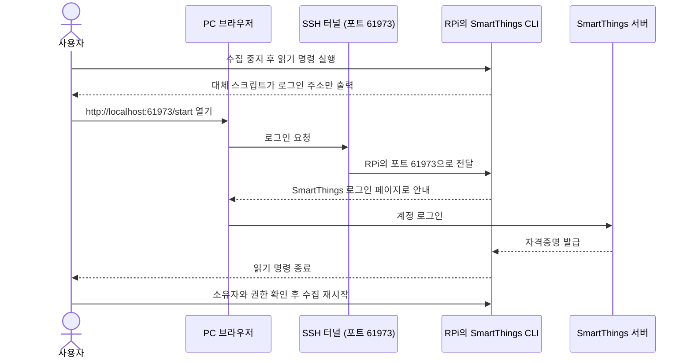

# stcollector — SmartThings 센서 로컬 수집기

## 개요

- SmartThings 센서 데이터를 받아 Raspberry Pi 안의 SQLite에만 저장
- 이 문서: 설치 안내
- 운영, 장애 대응, 보드 교체, 구조: [문서 지도](docs/README.md)
- 설계와 전체 계획: [PLAN.md](PLAN.md)

### 구현 상태

- 구현 범위: M0(준비), M1(수집), M2(집계), M3·M4(대시보드)
- 배포: 2026-11-10 01:15 KST 완료. `stcollector`, `stcollector-web`, `stcollector-sysmon`, `stcollector-rollup.timer` 활성화, 부팅 시 자동 시작
- RPi에서 확인됨: 서비스 샌드박스 안 CLI 동작(기기 25개, 수집 방식 `history`), 설치·이전 스크립트 실행, PC에서 `http://<RPi IP>:8080` 응답
- 아직 미확인: CLI 토큰 자동 갱신, 실제 데이터로 본 대시보드와 첫 집계, 만료 시 재인증 출력, 스마트폰 로그인. 전체 목록은 [RPi 미확인 항목](docs/OPERATIONS.md#rpi-미확인-항목)
- 자동 백업(M5): 미구현

### 의존성과 보안 전제

- Python 코드: 3.11+ 표준 라이브러리만 사용
- Python 외 실행 의존성: SmartThings CLI 하나(3.0.0, linux-arm64 단일 실행 파일)
- 나가는 연결: SmartThings 서버로 나가는 HTTPS뿐
- 들어오는 연결: 집 안 네트워크에서 대시보드와 SSH로 오는 접속뿐
- **CLI 자격증명의 권한: `controller:stCli`, 읽기 전용 아님**
- 읽기 제한: 수집기 코드의 명령 허용 목록으로 읽기 명령만 실행
- 허용 목록은 수집기 안의 제한이라 자격증명 파일이 유출되면 막지 못함
- 파일 보호: `stcollector` 계정 전용(파일 600, 폴더 700)

---

## M0. 준비

### 1) Raspberry Pi 기본 설정

- 모니터와 키보드: 불필요
- 연결: RPi를 공유기에 이더넷으로 연결, 같은 공유기에 연결된 PC에서 SSH로 설정

1. PC에서 SSH 키 생성. `C:\Users\<사용자>\.ssh\id_ed25519.pub` 파일의 내용을 다음 단계에서 사용

   ```bash
   ssh-keygen -t ed25519
   ```

2. Raspberry Pi Imager 설정
   - 장치: Raspberry Pi 3
   - OS: Raspberry Pi OS Lite (64-bit, Bookworm 이상)
   - OS 설정 화면: 호스트명(예: `homesensor`), 사용자와 비밀번호, 시간대 입력
   - SSH: 켠 뒤 공개키 인증만 허용 선택, 위 공개키 붙여 넣기

3. uSD와 LAN 케이블 연결 후 전원 투입. 첫 부팅은 파티션 확장과 재부팅 때문에 몇 분 소요. PC에서 접속

   ```bash
   ssh <사용자>@homesensor.local
   ```

   - 이름으로 접속되지 않을 때: 공유기 관리 페이지의 접속 기기 목록에서 IP를 찾아 그 IP로 접속
   - 접속 후: 공유기에서 RPi에 고정 IP 할당

4. SSH 접속 상태에서 패키지 갱신, 도구 설치, 시간대 설정

   ```bash
   sudo apt update && sudo apt full-upgrade -y
   ```

   ```bash
   sudo apt install -y ufw unattended-upgrades sqlite3
   ```

   ```bash
   sudo timedatectl set-timezone Asia/Seoul
   ```

5. 방화벽 설정: 집 안 네트워크에서 오는 SSH만 허용
   - 대역 확인: `hostname -I` 로 RPi의 IP 확인 후 대역 맞춤(예: IP가 `192.168.0.x` 이면 아래 명령의 `192.168.0.0/24` 그대로)
   - **대역을 틀리면 SSH가 막히고, 모니터가 없으면 복구가 어려움**
   - 적용 후: 지금 창을 닫지 말고 새 창에서 SSH 접속 확인

   ```bash
   sudo ufw default deny incoming && sudo ufw default allow outgoing && sudo ufw allow from 192.168.0.0/24 to any port 22 proto tcp && sudo ufw enable
   ```

6. microSD 쓰기를 줄이기 위한 로그 용량 제한: `/etc/systemd/journald.conf` 의 `[Journal]` 섹션에 `SystemMaxUse=64M` 추가 후 `sudo systemctl restart systemd-journald` 실행
7. 운영 설정(BT·Wi-Fi 끔, 900MHz, 1코어) 적용 후 재부팅

   | 항목 | 파일 | 설정 |
   |---|---|---|
   | Bluetooth 끔 | `/boot/firmware/config.txt` | `dtoverlay=disable-bt` |
   | Wi-Fi 끔 | `/boot/firmware/config.txt` | `dtoverlay=disable-wifi` |
   | 클럭 제한 | `/boot/firmware/config.txt` | `arm_freq=900` |
   | 1코어 | `/boot/firmware/cmdline.txt` (한 줄 유지) | `maxcpus=1` |

   - 설정 이유와 되돌리는 방법: [전원 시험 결과](docs/POWER_TEST.md)
   - 현재 운영 전원: QC5V + 15cm 케이블
   - 시험 범위: DZ5V3A와 QC5V(15cm 케이블)로 각각 약 12분. 다른 어댑터나 케이블에는 그대로 적용 불가
   - Wi-Fi를 끄므로 유선 이더넷 필수
   - 재부팅 후 `nproc` 이 `1`: 코어 설정 적용 상태
   - 전압 상태: 지금 쓰는 어댑터로 운영 중에 `vcgencmd get_throttled` 실행
   - `throttled=0x0`: 부팅 후 전압 부족과 스로틀링 기록 없음

#### (선택) 나중에 모니터나 KVM을 연결할 때

- 증상: KVM이 다른 PC 쪽을 보고 있는 상태로 RPi가 부팅되면 HDMI 출력이 안 잡혀, 나중에 전환해도 화면이 안 나올 수 있음
- 조치: `/boot/firmware/cmdline.txt` 의 **한 줄 끝에** 공백을 두고 아래 값을 덧붙인 뒤 재부팅. 해상도는 모니터에 맞춤

  ```text
  video=HDMI-A-1:1920x1080@60D
  ```

- 콘솔의 제약: PC와 복사·붙여넣기 불가, CLI 로그인에 필요한 SSH 터널 사용 불가. 로그인은 SSH로 진행
- 콘솔 자동 로그인: 켜지 않는 것을 권장. 기본 사용자가 비밀번호 없이 sudo를 쓰도록 설정돼 있으면 화면만 켜도 자격증명까지 접근 가능

### 2) SmartThings CLI 받기 (RPi에서 1회)

- 기본 수집 방식: 무료인 CLI 로그인. OAuth 앱 생성에는 유료 Developer Plan(보도상 월 $4.99) 필요
- OAuth 사용 시: 아래 [선택: OAuth 방식](#선택-oauth-방식)
- 다운로드: [SmartThings CLI 릴리스](https://github.com/SmartThingsCommunity/smartthings-cli/releases)에서 linux-arm64용 파일을 받아 RPi의 `~/st-cli/smartthings` 에 실행 파일로 배치
- 검증한 버전: 3.0.0
- 설치와 로그인: M1에서 진행

---

## M1. 설치와 수집 시작 (RPi)

### 1) 코드 복사와 설치

1. PC의 이 폴더에서 RPi로 복사. 받을 폴더를 먼저 생성

   ```bash
   ssh <사용자>@<RPi IP> "mkdir -p ~/stcollector-src"
   ```

   ```bash
   scp -r stcollector deploy config.example.toml <사용자>@<RPi IP>:~/stcollector-src/
   ```

2. RPi에서 설치

   ```bash
   cd ~/stcollector-src && chmod +x deploy/install.sh && sudo ./deploy/install.sh
   ```

- CLI 바이너리가 `~/st-cli/smartthings` 가 아닌 곳에 있을 때: `sudo ./deploy/install.sh --cli-binary /경로/smartthings` 로 지정

설치 스크립트가 하는 일 (다시 실행해도 기존 설정, DB, 자격증명은 유지):

- 전용 계정 `stcollector`(로그인 불가) 생성
- 코드를 `/opt/stcollector`(root 소유, 읽기만)에 배치
- CLI를 `/opt/stcollector-cli/smartthings`(root 소유, 750, 그룹 `stcollector`)에 배치. 서비스 계정은 쓰기 불가, 실행만 가능
- 설정을 `/etc/stcollector/config.toml`(640)에 배치
- 데이터를 `/var/lib/stcollector`(700)에, CLI의 `HOME`을 `/var/lib/stcollector/cli`(`stcollector` 소유, 700)에 배치
- 보안 제한을 건 systemd 서비스 등록. 수집 서비스만 CLI 실행을 위해 `MemoryDenyWriteExecute` 해제

### 2) 설정 입력

```bash
sudo nano /etc/stcollector/config.toml
```

- 처음 설치: `backend = "cli"` 가 이미 들어 있어 기본값으로 시작 가능
- 위치가 여러 개일 때: `location_id` 입력
- 이전에 설치했던 RPi: 기존 파일이 유지되므로 `[smartthings]` 섹션 안에 아래 네 줄을 직접 입력
- 주의: 파일 맨 끝에 넣으면 다른 섹션의 값이 되어 미적용

```toml
backend = "cli"
cli_path = "/opt/stcollector-cli/smartthings"
cli_home = "/var/lib/stcollector/cli"
cli_timeout_s = 120
```

### 3) CLI 자격증명 이전

- 대상: `homesensor` 계정으로 CLI에 로그인해 둔 경우, 자격증명을 서비스 계정으로 이전
- 스크립트 동작: 내용을 출력하지 않고, 복사본을 검증한 뒤 원본 삭제
- 로그인한 계정 이름이 다를 때: `--from-user 계정` 추가

```bash
cd ~/stcollector-src && sudo bash deploy/migrate-cli-credentials.sh
```

- 아직 로그인한 적이 없을 때: 이 단계 대신 [CLI 로그인과 재로그인](#cli-로그인과-재로그인) 진행

### 4) 점검

```bash
stcollector check
```

확인 항목:

- 수집 대상 기기 목록 (센서 10기와 플러그 표시 여부)
- 상태 조회 결과와 센서가 보고한 시각
- 이벤트 이력 API 사용 가능 여부와 정렬 순서 (PLAN §12-5)

### 5) 수집 시작

```bash
sudo systemctl enable --now stcollector
```

```bash
journalctl -u stcollector -f
```

- 첫 실행: SmartThings에 남아 있는 최근 이력(최대 7일, `backfill_days`)을 먼저 수신

### 6) 1주 후: 센서별 보고 간격

```bash
stcollector intervals --days 7
```

- 활용: 수집 주기와 센서 설정(보고 주기·민감도) 조정 여부 결정 (PLAN §6.1)

---

## CLI 로그인과 재로그인

- 방식: RPi에 브라우저가 없으므로 SSH 터널을 통해 PC 브라우저로 로그인
- CLI 동작: 별도의 로그인 명령 없음, 자격증명이 필요할 때 로그인 페이지 자동 표시
- RPi의 `xdg-open` 대체 스크립트(`deploy/cli/xdg-open`, 설치 위치 `/opt/stcollector-cli/login-bin/xdg-open`): 브라우저를 여는 대신 주소만 출력



1. PC에서 터널을 연 SSH로 접속. 로그인이 끝날 때까지 이 창 유지

   ```bash
   ssh -L 61973:localhost:61973 <사용자>@<RPi IP>
   ```

2. 그 SSH 창에서 수집 중지

   ```bash
   sudo systemctl stop stcollector
   ```

3. 재로그인이면 기존 로그인 상태 삭제. 처음 로그인할 때는 생략. `logout` 명령은 RPi 미확인

   ```bash
   cd / && sudo -u stcollector env HOME=/var/lib/stcollector/cli PATH=/opt/stcollector-cli/login-bin:/usr/bin:/bin /opt/stcollector-cli/smartthings logout
   ```

4. 읽기 명령을 실행해 로그인 시작. 기기 목록은 화면에 남지 않도록 폐기

   ```bash
   cd / && sudo -u stcollector env HOME=/var/lib/stcollector/cli PATH=/opt/stcollector-cli/login-bin:/usr/bin:/bin /opt/stcollector-cli/smartthings devices --json > /dev/null
   ```

5. PC 브라우저에서 `http://localhost:61973/start` 를 열어 SmartThings에 로그인. 로그인이 끝나면 4번 명령 종료
6. 소유자와 권한 확인. `stcollector 600` 이 정상. 파일 내용 열람 금지

   ```bash
   sudo stat -c '%U %a' /var/lib/stcollector/cli/.local/share/@smartthings/cli/credentials.json
   ```

7. 수집 재시작

   ```bash
   sudo systemctl start stcollector
   ```

### 확인되지 않은 사항: CLI 토큰 자동 갱신

- CLI가 만료된 액세스 토큰을 스스로 갱신하는지: 아직 미확인
- 현재 액세스 토큰의 만료 시각: 2026-11-10T15:06Z (2026-11-11 00:06 KST)
- 리프레시 토큰: 자격증명에 포함, 유효기간은 미확인

만료 시각이 지난 뒤 확인 절차:

1. 자격증명 파일의 수정 시각을 만료 전에 기록하고 만료 후 비교. 내용을 읽지 않는 명령

   ```bash
   sudo stat -c '%y' /var/lib/stcollector/cli/.local/share/@smartthings/cli/credentials.json
   ```

2. 만료 후 `stcollector check` 가 성공하고 `journalctl -u stcollector` 에 인증 오류가 없으면 갱신 동작으로 판단

- 갱신이 되지 않을 때: 위 재로그인 절차를 만료 때마다 반복해야 하므로 무인 수집 방식 재결정 필요

---

## M2~M4. 집계와 대시보드 (RPi)

- 실행 위치: 수집기와 같은 RPi
- 외부 라이브러리와 외부 서비스 미사용, 화면도 외부 요청 없음

### 1) 코드 갱신

1. PC의 이 폴더에서 복사

   ```bash
   scp -r stcollector deploy config.example.toml <사용자>@<RPi IP>:~/stcollector-src/
   ```

2. RPi에서 설치 스크립트 재실행. 설정, DB, CLI 자격증명은 유지되고 `[rollup]`, `[web]`, `[sysmon]` 항목만 없을 때 추가

   ```bash
   cd ~/stcollector-src && sudo ./deploy/install.sh
   ```

### 2) 집계 시작

- 주기: 매시 2분에 끝난 시간까지 집계
- 첫 실행: 쌓인 원본 전체를 계산

```bash
sudo systemctl enable --now stcollector-rollup.timer
```

- 바로 한 번 실행

```bash
stcollector rollup
```

### 3) 대시보드 비밀번호

- 비밀번호 미설정 시: 웹서버 시작 거부
- 아래 명령: 비밀번호를 해시로만 변환해 출력

1. 해시 생성

   ```bash
   stcollector hash-password
   ```

2. 출력된 `password_hash = "..."` 줄로 설정 파일의 `[web]` 섹션에 있는 같은 줄을 교체

   ```bash
   sudo nano /etc/stcollector/config.toml
   ```

### 4) 방화벽과 서비스

```bash
sudo ufw allow from 192.168.0.0/24 to any port 8080 proto tcp
```

```bash
sudo systemctl enable --now stcollector-web
```

```bash
systemctl status stcollector-web
```

```bash
sudo systemctl enable --now stcollector-sysmon
```

- `stcollector-sysmon`: 상태 탭에 나오는 RPi 온도, 클럭, 전압 부족 이벤트 기록

### 5) 접속

- 주소: 같은 공유기에 연결된 스마트폰이나 PC 브라우저에서 `http://<RPi IP>:8080`
- 스마트폰 아이콘: 브라우저 메뉴의 '홈 화면에 추가'. HTTP 접속이라 Android Chrome에서는 독립 앱 창이 아니라 브라우저 바로가기로 열릴 수 있음
- 요약 화면 구성: 방별 현재값 띠(온도 크게, 습도·조도·재실), 온도 큰 차트 1개, 습도·조도 작은 차트 2개, 방별 상태 표
- 차트: 끝난 시간까지의 집계를 표시
- 요약 화면의 현재값과 오늘 최고·최저: 최신 측정값까지 반영
- 비밀번호 변경: 해시를 새로 넣고 `sudo systemctl restart stcollector-web` 실행. 기존 로그인 모두 해제
- 공유기 대역이 `192.168.0.x` 가 아니게 될 때: ufw 규칙, `config.toml` 의 `allowed_networks`, `stcollector-web.service` 의 `IPAddressAllow` 를 함께 변경
- 집계 규칙 조정과 수동 실행: [운영 문서](docs/OPERATIONS.md#집계-수동-실행)

---

## 선택: OAuth 방식

- 조건: OAuth-In 앱을 만들고 관리하려면 유료 SmartThings Developer Plan(보도상 월 $4.99) 필요
- 장점: 권한을 읽기 전용(`r:devices:*`, `r:locations:*`)으로 축소 가능, CLI를 수집에 사용하지 않음

1. PC에서 앱 생성. CLI 3.0.0부터 `apps*` 명령은 `smartapps*` 로 변경. Client Secret 재발급은 `smartthings smartapps:oauth:generate` 사용

   ```bash
   smartthings smartapps:create
   ```

2. 질문별 입력값

   | 질문 | 답 |
   |---|---|
   | 앱 종류 | **OAuth-In App** |
   | Display Name / Description | 자유 (예: `home-sensor-collector`) |
   | Icon Image URL, Target URL | 비워 둠 |
   | Scopes | **`r:devices:*`, `r:locations:*`** 만 선택 |
   | Redirect URIs | `https://localhost/callback` |

3. 마지막에 출력되는 OAuth Client Id와 OAuth Client Secret을 안전한 곳에 기록. Secret은 이때 한 번만 표시
4. `/etc/stcollector/config.toml` 의 `[smartthings]` 에서 `backend = "oauth"` 로 변경, `client_id`, `client_secret`, `redirect_uri`, `scopes` 의 주석을 풀어 값 입력
5. `stcollector auth` 실행 후 출력된 URL을 브라우저에서 승인, 주소창의 `https://localhost/callback?code=...&state=...` 전체를 터미널에 붙여 넣기. 브라우저에 "페이지를 열 수 없음"이 떠도 정상

---

## M1 완료 기준 확인

| 항목 | 확인 방법 |
|---|---|
| 24시간 연속 수집 | `systemctl status stcollector` 에서 계속 active, 로그에 오류 반복이 없음 |
| CLI 토큰 자동 갱신 | 액세스 토큰 만료 후에도 수집이 이어지고 인증 오류가 없음 ([확인 방법](#확인되지-않은-사항-cli-토큰-자동-갱신)) |
| 수집 방식 확정 | `sudo -u stcollector sqlite3 /var/lib/stcollector/sensors.db "select value from meta where key='mode'"` |
| 보고 간격 리포트 | `stcollector intervals` |

## 문제 해결

- 증상별 조치: [운영 문서의 장애 대응](docs/OPERATIONS.md#장애-대응)
- 보드나 microSD 고장: [보드 교체와 복구](docs/MIGRATION.md)

## 개발 (PC)

- 단위 테스트

```bash
python -m unittest discover -s tests -t .
```

- 화면 개발용 가짜 데이터 (실제 DB에 사용 금지)

```bash
python tools/generate_fake_data.py --db data/fake.db --days 400
```

## 파일 구성

```
stcollector/
  config.py      설정 로드·검증
  transport.py   OAuth 방식의 HTTPS 전용, 리다이렉트 차단 HTTP 계층
  auth.py        OAuth 방식 승인·토큰 자동 갱신 (원자적 저장, 600)
  cli_client.py  SmartThings CLI 호출 (읽기 명령 허용 목록, 현재 기준)
  client.py      OAuth 방식 API (재시도, 429 대응, 다른 호스트로 토큰 전송 차단)
  collector.py   수집 루프 (이벤트 이력 우선, 상태 조회 대안)
  db.py, schema.sql  SQLite 저장 (WAL, 중복 제거)
  intervals.py   보고 간격 리포트
  rollup.py      시간·일·주 집계, 조도 구간, 재실, 원본 정리
  settings.py    [rollup], [web], [sysmon] 설정
  sysmon.py      RPi 상태 모니터 (sysfs와 /proc만 읽음, 별도 sysmon.db)
  web/           대시보드 (표준 라이브러리 HTTP 서버, 자체 SVG 차트)
deploy/
  install.sh                     코드, CLI, 설정, systemd 설치
  migrate-cli-credentials.sh     CLI 자격증명을 서비스 계정으로 이전
  cli/xdg-open                   헤드리스 로그인용 (주소만 출력)
  stcollector                    명령행 래퍼
  systemd/                       수집, 웹, 집계 timer, 모니터
docs/
  README.md        문서 지도
  ARCHITECTURE.md  코드 흐름, DB 테이블, 서비스, 보안 경계
  OPERATIONS.md    일상 점검, 장애 대응, RPi 미확인 항목
  MIGRATION.md     보드 교체와 복구
  POWER_TEST.md    RPi 전원 시험 결과와 운영 설정
tools/           가짜 데이터 생성기
tests/           단위 테스트
```
