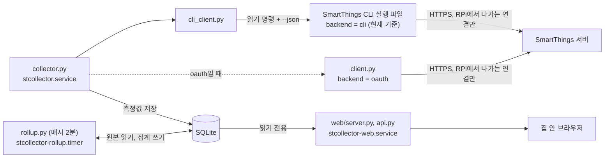
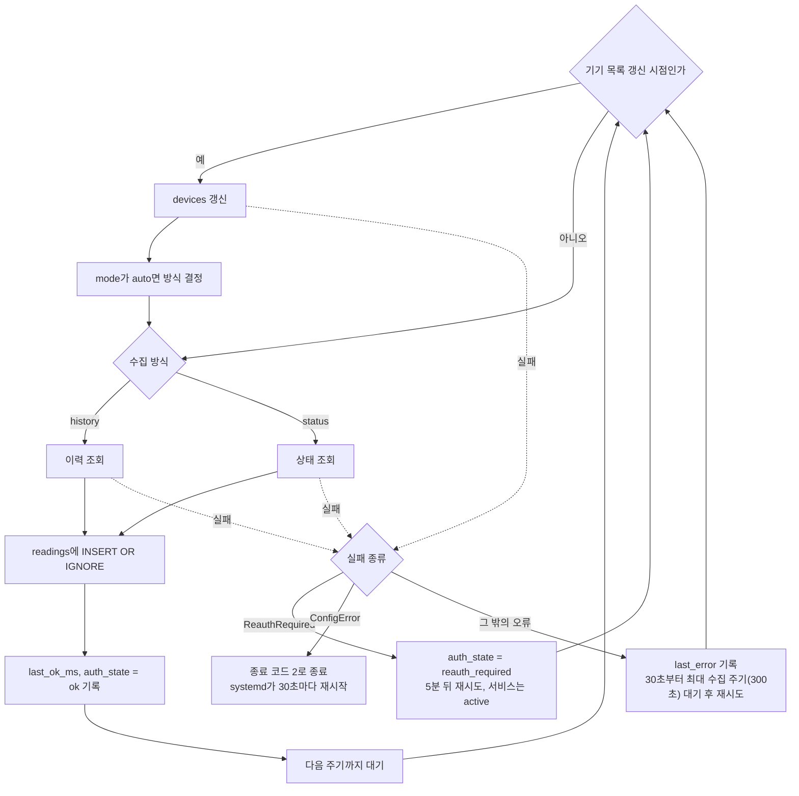
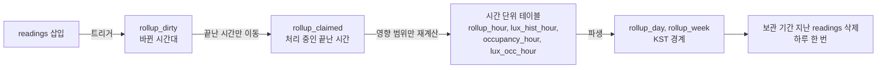
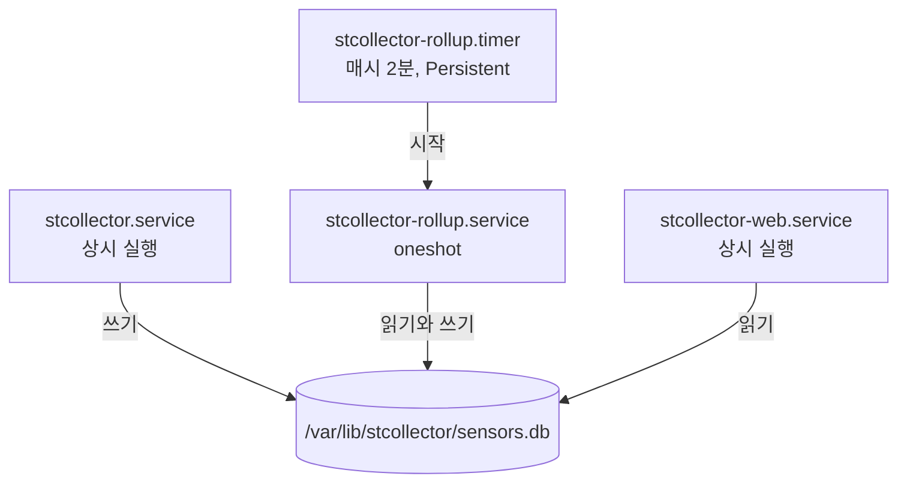
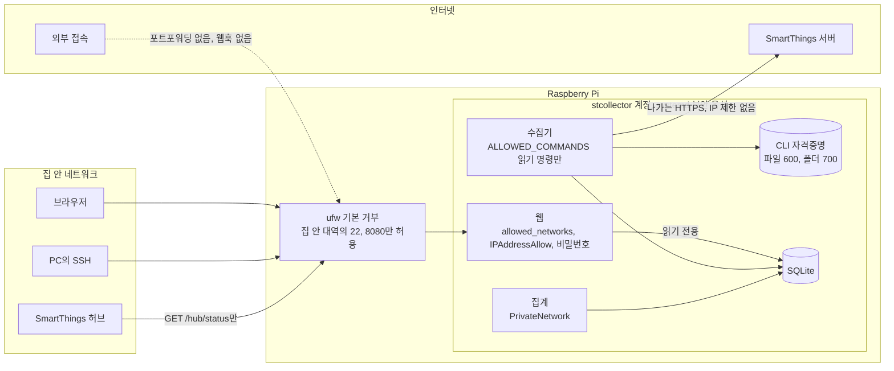

# 구조

- 범위: 지금 코드의 동작
- 왜 이렇게 정했는지와 앞으로의 단계: [PLAN](../PLAN.md)
- 코드를 직접 읽어 작성. RPi에서 시험하지 못한 내용은 "RPi 미확인"으로 표시

## 전체 흐름



- 수집, 집계, 웹은 서로 직접 호출하지 않고 DB로만 연결
- 하나가 멈춰도 나머지는 계속 동작
- 그림에 없는 `stcollector-sysmon`: RPi 상태만 기록, 수집 DB와 분리된 `sysmon.db` 사용

## 수집

- 클라이언트 선택: `__main__.py`의 `_build()`가 설정의 `backend`로 결정
- 설정 파일에서 이 줄을 지울 때: 코드 기본값 `"oauth"`로 동작

### CLI 클라이언트 (`cli_client.py`)

- 실행 범위: `ALLOWED_COMMANDS`에 있는 읽기 명령만 실행
  - `locations`, `locations:rooms`, `locations:history`, `devices`, `devices:status`, `devices:history`
  - 제어 명령 추가 금지
- 실행 방식: 셸 없이 인자 배열로 실행, 위치 인자와 옵션 값은 정규식으로 검사
- 환경 변수: `HOME`(`cli_home`), `PATH`, `LANG`, `NO_COLOR`만 전달
- `PATH`: 로그인용 `login-bin`이 없어 수집 중에는 `xdg-open` 대체 스크립트 미사용
- 로그인 정보 파일이 없을 때: CLI를 실행하지 않고 `ReauthRequired` 발생. 실행하면 브라우저 로그인을 기다리다 시간 초과되기 때문
- 로그인 만료 감지: 출력에서 만료로 보이는 문구를 찾아 `ReauthRequired`로 변환. 실제 만료 때의 출력은 RPi 미확인
- 오류 문구: `sanitize()`로 토큰처럼 보이는 값을 가린 뒤 로그에 기록
- 재시도: HTTP 429나 5xx로 보이는 실패는 30초 뒤 1회
- 이력 페이징
  - `--after`를 앞으로 옮겨 과거에서 최신 방향으로 읽음. 페이지 크기 상한 100건
  - `--after` 없는 기기별 조회: `--before`를 옮겨 최신에서 과거 방향으로 읽음
  - 실제 CLI 출력과 대조해 반영

### OAuth 클라이언트 (`client.py`, `auth.py`, `transport.py`)

- 위치: 선택지로 남겨 둔 HTTP 방식
- `transport.py`: HTTPS만 허용, 리다이렉트 차단
- `client.py`: 다른 호스트로 토큰 전송 차단
- 토큰 저장: `token.json`(600)

### 수집 루프 (`collector.py`)

| 단계 | 동작 |
|---|---|
| 기기 목록 | 시작할 때와 `device_refresh_s`(기본 하루)마다 `devices` 테이블 갱신. 수집 대상 capability가 없는 기기 제외 |
| 방식 결정 | `mode = "auto"`면 이력 조회 시험. HTTP 400, 403, 404면 `status`, 성공하면 `history`로 정하고 `meta.mode`에 기록 |
| 이력 방식 (CLI) | `history_interval_s`(기본 300초)마다 `locations:history` 위치 단위 조회 |
| 이력 방식 (OAuth) | 기기마다 이력 조회 |
| 상태 방식 (CLI) | `devices --status` 1회로 전 기기 조회, `history_interval_s`보다 자주 읽지 않음 |
| 상태 방식 (OAuth) | 기기별로 `status_interval_s` 주기에 맞춰 조회 |
| 저장 | `INSERT OR IGNORE`로 삽입, `readings` 기본 키가 같으면 버림 |

#### 수집 한 주기



#### CLI 이력의 진행 위치와 빈틈 메우기

- 시작점: `meta`의 `history_cursor:<위치>` 하나. 처음이면 `backfill_days`(기본 7일) 전부터 조회
- 겹침 조회: 매번 10분을 겹쳐 늦게 도착한 이벤트 수신, 중복은 DB가 제거
- 커서 이동: 페이지마다 저장. 실패, 종료, 페이지 한도 뒤에는 그 지점부터 다음 주기에 이어서 조회
- 페이지 한도: 첫 조회는 `history_backfill_max_pages`(기본 100페이지), 이후 주기는 `history_max_pages`(기본 20페이지)
- 새로 추가된 기기: `devices:history`로 따로 채움

#### 오류 처리

| 오류 | 동작 |
|---|---|
| `ReauthRequired` | `meta.auth_state = reauth_required` 기록, 5분 뒤 재시도. **프로세스가 끝나지 않아 서비스는 active로 표시** |
| `ConfigError` | 프로세스가 종료 코드 2로 종료, systemd가 30초마다 재시작 |
| 이력 조회 실패 (HTTP 500 등) | 아래 오류와 같이 재시도. `meta.history_fail_since_ms`, `history_failures` 기록. 2회 연속 실패부터 수집 주기마다 `devices --status`로 현재값만 임시 저장(`status_fallback_ms`). 위치 커서는 그대로라 회복 뒤 밀린 이력을 다시 받음. 10분 넘게 이어지면 대시보드 경고 |
| 그 밖의 오류 | `meta.last_error`에 기록, 30초부터 최대 수집 주기(`history_interval_s`, 기본 300초)까지 대기를 늘려 재시도. 서버·CLI 오류는 스택 없이 한 줄로 로그 |

- 성공할 때마다 기록: `meta.last_ok_ms`, `auth_state = ok`

## 집계 (`rollup.py`)

- 규칙의 이유: [PLAN §7](../PLAN.md#7-저장--집계)

### 처리 순서



1. `readings` 삽입 트리거가 바뀐 시간대를 `rollup_dirty`에 표시
2. 끝난 시간의 표시를 `rollup_claimed`로 옮겨 처리. 처리 중 도착한 값은 `rollup_dirty`에 새로 누적
3. 항목별 영향 시간 범위 계산. 이전 값이 다음 시간까지 유지될 수 있어 `max_hold_s`만큼 뒤쪽 범위까지 확장
4. `rollup_hour`, `lux_hist_hour`, `occupancy_hour`, `lux_occ_hour`를 그 범위만 지우고 다시 기록
5. `rollup_day`, `rollup_week`를 시간 집계에서 파생. 경계는 KST, 주는 월요일 시작. 값이 그대로면 기록하지 않아 microSD 쓰기 절감
6. 하루 한 번 보관 기간이 지난 `readings` 삭제(`retention_days`, 기본 365일). 항목별 최신 보고 1건 유지, 집계 테이블은 삭제 안 함

### 전체 재계산

- 조건: 처음 실행이거나 `--full`
- 범위: 남아 있는 원본 전체
- 같은 구간을 다시 계산해도 결과 동일

## 웹 (`web/`)

- `server.py`
  - `ThreadingHTTPServer` 기반
  - 정적 파일은 시작할 때 메모리에 적재, 요청 경로는 그 표에서만 조회
  - 시작 때 스키마 적용 후 요청마다 읽기 전용(`mode=ro`) DB 연결 사용
- `api.py`
  - JSON API
  - 차트는 집계 테이블에서만 조회
  - `readings`는 최신값과 아직 집계되지 않은 오늘 구간의 최대·최소에만 사용
  - `/hub/status`: SmartThings 허브용 요약 (아래 [허브 상태 경로](#허브-상태-경로-hubstatus))
- `session.py`
  - scrypt 비밀번호 검증과 서명된 세션 쿠키
  - 세션 키는 비밀번호 해시에서 유도해 재시작해도 유지
  - 비밀번호를 바꾸면 기존 세션 모두 무효
- `static/`
  - 화면 코드와 자체 SVG 차트(`charts.js`)
  - 외부 자원 불러오지 않음

### 화면

- 탭: 요약, 추세, 조도 분포, 재실, 플러그, 상태
- 요약 탭: 방별 현재값 띠(온도 크게, 습도·조도·재실), 최근 24시간 온도 큰 차트 1개, 습도·조도 작은 차트 2개, 방별 상태 표
- 조도 화면의 색: 전구색 계열
- 상태 탭: RPi 현재값, 최근 24시간 온도·클럭·load, 이벤트 로그, 수집 상태, 센서별 마지막 보고

### API 캐시

| API | 캐시 기준 |
|---|---|
| `/api/series`, `/api/lux-dist`, `/api/occupancy`, `/api/plugs` | 집계 완료 시각과 현재 시 |
| `/api/summary`, `/api/status`, `/api/meta`, `/api/system` | 15초 |

### 화면 상단 경고

- 생성 위치: `api.alerts()`

| 경고 | 조건 |
|---|---|
| 재인증 필요 | `auth_state = reauth_required` |
| 수집 중단 | 마지막 성공 후 30분 초과 |
| 집계 지연 | 마지막 집계 후 2시간 10분 초과 |
| 디스크 부족 | 여유 공간 1GB 미만 |
| 배터리 부족 | 20% 미만 |
| 전압 부족, 스로틀링, 과열 | 모니터 현재값이 30초 안에 갱신됐고 해당 상태가 진행 중 |

### 허브 상태 경로 (`/hub/status`)

- 용도: SmartThings Hub V3의 Edge 드라이버([edge-driver/](../edge-driver/README.md))가 60초마다 읽어 SmartThings 앱 기기로 표시
- 접근: 로그인 없음. `[web] hub_status_allow`에 적힌 IP 주소만 200, 그 밖과 목록이 빈 경우 404. `allowed_networks` 검사보다 먼저 판정
- 방식: GET·HEAD만, 캐시 없음(`Cache-Control: no-store`). 새로 측정하지 않고 수집 DB `meta`, 모니터 현재값 파일, `shutil.disk_usage`만 읽음
- 응답에 넣지 않는 것: 기기·방 이름, 위치 ID, 오류 문구(`last_error`), 비밀값
- 생성 위치: `api.hub_status()`, 판정은 `api.collect_health()`

```json
{"now_ms":1763010300000,"collect_ok":true,"collect_state":"ok","collect_text":"정상",
 "last_ok_ms":1763010000000,"last_ok_text":"11-13 14:00","cpu_temp_c":52.6,"cpu_mhz":900.0,
 "load1":0.31,"disk_used_pct":76.2,"sysmon_fresh":true}
```

| 필드 | 출처 |
|---|---|
| `collect_ok`, `collect_state`, `collect_text` | 아래 판정 |
| `last_ok_ms`, `last_ok_text` | `meta.last_ok_ms`, 글자는 KST `월-일 시:분` |
| `cpu_temp_c`, `cpu_mhz`, `load1` | 모니터 현재값. 30초 넘게 갱신되지 않았으면 `null`, `sysmon_fresh = false` |
| `disk_used_pct` | DB가 있는 파일 시스템의 사용률 |

수집 판정 (위에서부터 먼저 맞는 것)

| `collect_state` | 조건 | `collect_ok` |
|---|---|---|
| `reauth` | `auth_state = reauth_required` | false |
| `unknown` | `last_ok_ms` 없음 | false |
| `stopped` | 마지막 수집 성공 후 30분 초과 | false |
| `history` | 이력 조회 연속 실패가 10분 초과 | 60분 이하 true, 초과 false |
| `ok` | 그 밖 | true |

- 30분, 10분은 화면 상단 경고와 같은 기준. 이력 실패 중에도 현재값은 임시 수집되므로 1시간까지는 이상으로 보지 않음
- 앱의 `contactSensor`는 `collect_ok = false`이면 열림. 허브가 3회 연속 못 읽어도 열림(드라이버 판정)

## DB 테이블

- 정의의 원본: `stcollector/schema.sql`
- 시각: 모두 UTC epoch 밀리초로 저장, 화면에서만 KST로 변환
- 저널 방식: WAL
- 웹: 시작 때 스키마 적용을 제외하면 읽기만 수행

| 테이블 | 역할 | 쓰는 쪽 |
|---|---|---|
| `meta` | 키-값 상태. `mode`, `auth_state`, `last_ok_ms`, `last_error`, `last_error_ms`, `location_id`, `history_cursor:<위치>`, `rollup_closed_until_ms`, `rollup_finished_ms`, `rollup_retention_ms`, `schema_version` | 수집, 집계 |
| `devices` | 기기, 방, 위치, capability 목록 | 수집 |
| `readings` | 원본 측정값. 기본 키는 (기기, 컴포넌트, capability, 속성, 보고 시각) | 수집 (삭제는 집계) |
| `cursors` | 기기별 마지막 수신 시각 | 수집 |
| `rollup_dirty` | 새 측정값이 들어온 시간대. 트리거가 채움 | 트리거, 집계 |
| `rollup_claimed` | 집계가 처리 중인 시간대 | 집계 |
| `rollup_series` | 집계가 아는 측정 항목 목록. `readings`를 훑지 않기 위해 둠 | 집계 |
| `rollup_hour`, `rollup_day`, `rollup_week` | 시간 가중 평균, 최소, 최대, 마지막 값, 건수, coverage | 집계 |
| `lux_hist_hour` | 조도 구간별 체류 시간(초) | 집계 |
| `occupancy_hour` | 재실 시간과 재실 여부를 알고 있던 시간 | 집계 |
| `lux_occ_hour` | 재실 중 조도 분포 | 집계 |

## 서비스와 타이머



- 타이머만 집계 서비스를 시작하고, 서비스끼리는 DB로만 연결
- 그림에 없는 `stcollector-sysmon.service`: 수집 DB를 쓰지 않는 상시 모니터

| 유닛 | 형태 | 실행 | 주요 제한 |
|---|---|---|---|
| `stcollector.service` | 상시, 실패 시 30초 뒤 재시작 | `run` | 나가는 네트워크 허용. CLI의 V8 JIT 때문에 `MemoryDenyWriteExecute=false` |
| `stcollector-web.service` | 상시, 실패 시 재시작. 종료 코드 2는 재시작 안 함 | `web` | `MemoryMax=128M`, 집 안 대역과 루프백만 통신 |
| `stcollector-rollup.service` | 1회 실행 (`oneshot`) | `rollup` | `MemoryMax=256M`, `Nice=10`, IO idle, `PrivateNetwork=true` |
| `stcollector-rollup.timer` | 매시 2분, 꺼져 있던 동안 놓치면 켜진 뒤 1회 | 위 서비스를 시작 | |
| `stcollector-sysmon.service` | 상시, 실패 시 30초 뒤 재시작. 종료 코드 2는 재시작 안 함 | `sysmon` | `MemoryMax=48M`, `Nice=5`, IO idle, `PrivateNetwork=true`, 자격증명 경로 접근 차단 |

- `install.sh`: 유닛 복사와 `daemon-reload`만 수행
- 활성화(`enable`): 사람이 직접 수행. 현재 RPi는 수집, 웹, 모니터, 집계 타이머 모두 활성화, 부팅 시 자동 시작
- 설치 시 재시작 대상: 이미 실행 중인 수집, 웹, 모니터만
- 유닛 사이의 `After=`, `Requires=` 의존 관계: 없음
- 중복 실행 방지: 수집기, 집계, 모니터가 각각 잠금 파일(`sensors.db.lock`, `sensors.db.rollup.lock`, `sysmon/sysmon.db.lock`) 사용
- 실행 계정: 수집, 웹, 집계, 모니터 모두 `stcollector`
- 공통 보안 옵션: `ProtectSystem=strict`, `ProtectHome=true`, `NoNewPrivileges=true` 등
- 쓰기 가능 위치: `StateDirectory`인 `/var/lib/stcollector`만. 모니터는 `/var/lib/stcollector/sysmon`과 `/run/stcollector-sysmon`만

## 파일 위치

| 경로 | 내용 | 소유, 권한 |
|---|---|---|
| `/opt/stcollector` | 코드 | root, 읽기만 |
| `/opt/stcollector-cli/smartthings` | CLI 실행 파일 | root:stcollector, 750 |
| `/opt/stcollector-cli/login-bin/xdg-open` | 헤드리스 로그인용 스크립트 | root:stcollector, 750 |
| `/usr/local/bin/stcollector` | 명령행 래퍼. `stcollector` 계정으로 전환해 실행 | root, 755 |
| `/etc/stcollector/config.toml` | 설정, 대시보드 비밀번호 해시 | root:stcollector, 640 |
| `/var/lib/stcollector/sensors.db` (`-wal`, `-shm`) | 데이터 | stcollector, 폴더 700 |
| `/var/lib/stcollector/cli/.local/share/@smartthings/cli/credentials.json` | CLI 자격증명 | stcollector, 파일 600, 폴더 700 |
| `/var/lib/stcollector/cli/.local/state/@smartthings/cli/smartthings.log` | CLI 자체 로그 | stcollector |
| `/var/lib/stcollector/token.json` | OAuth 토큰 (OAuth 방식일 때만) | stcollector, 600 |
| `/var/lib/stcollector/sysmon/sysmon.db` | RPi 상태 1분 요약과 이벤트 | stcollector, 폴더 700 |
| `/run/stcollector-sysmon/current.json` | RPi 상태 현재값 (tmpfs) | stcollector, 폴더 700 |

## 보안 경계



| 경계 | 막는 수단 | 한계 |
|---|---|---|
| 인터넷 → RPi | 포트포워딩 없음, 웹훅 없음, `ufw` 기본 거부 | 운영 설정에 의존, 코드가 강제하지 않음 |
| 집 안 네트워크 → 대시보드 | `ufw`, 앱의 `allowed_networks`, 웹 서비스의 `IPAddressAllow`, 비밀번호 | HTTP라서 비밀번호와 쿠키가 집 안 네트워크에서 암호화되지 않음. 쿠키에 `Secure` 적용 불가 |
| SmartThings 허브 → `/hub/status` | `hub_status_allow`에 적은 IP만, 읽기 전용 GET, 이름·오류 문구·비밀값 없는 요약 | 로그인 없음. 허브 IP를 다른 기기가 쓰면 같은 요약을 볼 수 있음 (공유기에서 허브 IP 고정) |
| 대시보드 로그인 | scrypt, IP별 5회 실패 시 5분 차단, `HttpOnly`·`SameSite=Lax` 쿠키, POST `Origin` 검사, 자체 출처만 허용하는 CSP | 로그인 전 접근 가능 범위는 로그인 화면, CSS, manifest, 아이콘 |
| 수집기 → 기기 제어 | `ALLOWED_COMMANDS` 허용 목록 | 수집기 안의 제한. 자격증명 파일 유출 시 차단 불가 |
| CLI 자격증명 파일 | `stcollector` 계정 전용 (파일 600, 폴더 700) | 권한은 `controller:stCli`로 제어까지 가능. 웹과 집계도 같은 계정으로 동작, sudo 사용자는 읽기 가능 |
| 프로세스 격리 | systemd 보안 옵션 | 수집 서비스는 나가는 IP 제한 없음 |
| 로그 | CLI 오류 문구 가림, 웹 접속 로그 없음 | CLI 자체 로그의 내용은 미확인 |

- DB 사본도 외부 업로드 금지: 기기 이름, 방 이름, 위치 ID 포함
