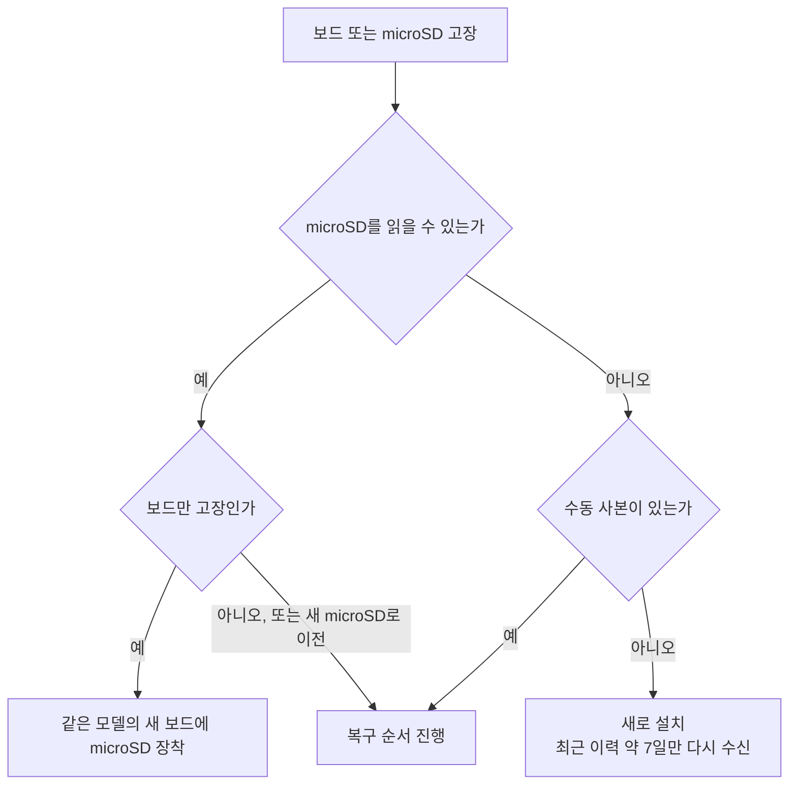
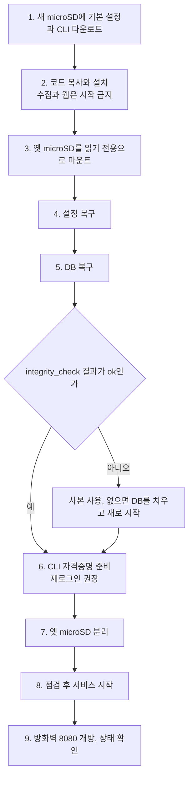

# 보드 교체와 복구

## 전제

- **자동 백업(M5): 미구현.** `deploy/`에 백업 서비스와 타이머 없음
- 아래 [수동 사본](#수동-사본-m5-전까지)이 없고 microSD가 읽히지 않으면 쌓인 데이터 복구 불가
- 복구 절차: RPi에서 미시험 (RPi 미확인)
- 파일 위치와 권한의 근거: `deploy/install.sh`

## 상황 선택



| 상황 | 할 일 |
|---|---|
| 보드만 고장, microSD 정상 | 같은 모델의 새 보드에 microSD를 그대로 장착. 옮길 것 없음. MAC 주소가 바뀌므로 공유기의 고정 IP 재할당, PC의 SSH `known_hosts`는 그대로 사용 |
| microSD가 읽히지만 부팅 안 됨, 또는 새 microSD로 이전 | [복구 순서](#복구-순서) 진행 |
| microSD가 읽히지 않고 사본도 없음 | 새로 설치. 수집을 시작하면 SmartThings에 남은 최근 이력(약 7일, `backfill_days`)만 다시 수신 |

- 다른 모델의 보드나 다른 어댑터로 교체: 운영 설정과 전원 시험 결과를 그대로 적용 불가. [POWER_TEST](POWER_TEST.md) 참고 후 `vcgencmd get_throttled`로 재확인

## 옮길 것

| 데이터 | 경로 | 비고 |
|---|---|---|
| DB | `/var/lib/stcollector/sensors.db`, 있으면 `sensors.db-wal`도 | **`-wal`이 있으면 반드시 함께 이전.** 최근 기록이 그 안에 있을 수 있음. `-shm`과 `*.lock`은 불필요 |
| 설정 | `/etc/stcollector/config.toml` | 대시보드 비밀번호 해시, `location_id` 포함. OAuth 방식이면 client secret도 포함 |
| CLI 자격증명 | `/var/lib/stcollector/cli/.local/share/@smartthings/cli/credentials.json` | **복사보다 재로그인 권장.** 아래 주의사항 먼저 확인 |
| OAuth 토큰 | `/var/lib/stcollector/token.json` | `backend = "oauth"`일 때만 존재 |

### 옮기지 않는 것

- 코드(`/opt/stcollector`), systemd 유닛, 명령행 래퍼: `install.sh`가 재생성
- CLI 실행 파일: 다시 다운로드
- CLI 자체 로그(`smartthings.log`): 내용 미확인이므로 이전 안 함
- RPi 상태 기록(`/var/lib/stcollector/sysmon/`): 새 보드에서 새로 생성

### 복구 시 참고

- 집계 테이블: DB 안에 있으므로 별도 이전 불필요
- DB는 일부가 아니라 파일 전체 이전: 보관 기간(기본 1년)이 지난 원본은 이미 삭제되어 재계산 불가
- 수집 재개: 복구한 DB의 수집 위치(`history_cursor`)로 멈춘 시점 10분 전부터 이어서 수신
- 빈틈 복구 범위: SmartThings에 이력이 남아 있는 기간(약 7일) 안

## CLI 자격증명 복사 시 주의사항

- 이 파일의 권한: `controller:stCli`로 **기기 제어까지 가능**
- 수집기의 읽기 명령 제한: 파일 유출 시 무의미
- 권장: 복사 대신 새 보드에서 [재로그인](../README.md#cli-로그인과-재로그인). 브라우저 로그인 1회
- 복사 경로: 옛 microSD를 **새 RPi에 직접** 연결. PC, USB 메모리, 클라우드 동기화 폴더 경유 금지
- 내용 출력 금지: `cat`, 편집기, 채팅, 이슈 붙여넣기 모두 금지
- 복사 후 확인: 소유자 `stcollector`, 파일 600, 상위 폴더 700
- **옛 보드와 새 보드를 같은 자격증명으로 동시 실행 금지.** 토큰 갱신 방식이 미확인이라 한쪽의 갱신이 다른 쪽을 무효로 만들 수 있음
- 옛 microSD: 자격증명이 남아 있으므로 재사용하거나 버리기 전에 물리적 파기. 덮어쓰기로 지워진다는 보장 없음
- `deploy/migrate-cli-credentials.sh`: 같은 보드의 로그인 사용자에게서 서비스 계정으로 옮기는 도구. 옛 microSD에서 복구할 때는 사용 안 함
- 유출 의심 시: [OPERATIONS: 자격증명 유출](OPERATIONS.md#자격증명-유출이-의심될-때) 절차

## 복구 순서

- 옛 보드: 전원 꺼 둠
- 명령 실행 위치: 새 RPi



1. 새 microSD에 [README M0](../README.md#m0-준비)의 기본 설정(OS, SSH, 방화벽, journald, 운영 설정)과 CLI 다운로드 진행
2. [README M1의 코드 복사와 설치](../README.md#1-코드-복사와-설치)까지 진행. **수집과 웹은 아직 시작 금지.** 새 DB가 없어야 함

   ```bash
   sudo ls -la /var/lib/stcollector/
   ```

3. 옛 microSD를 USB 리더로 연결하고 읽기 전용으로 마운트. `lsblk`로 장치 이름을 확인해 `sdX2`를 교체. 두 번째 파티션이 루트

   ```bash
   lsblk
   ```

   ```bash
   sudo mkdir -p /mnt/old && sudo mount -o ro /dev/sdX2 /mnt/old
   ```

4. 설정 복구

   ```bash
   sudo install -m 640 -o root -g stcollector /mnt/old/etc/stcollector/config.toml /etc/stcollector/config.toml
   ```

5. DB 복구

   ```bash
   sudo install -m 600 -o stcollector -g stcollector /mnt/old/var/lib/stcollector/sensors.db /var/lib/stcollector/sensors.db
   ```

   ```bash
   sudo sh -c 'f=/mnt/old/var/lib/stcollector/sensors.db-wal; [ ! -f "$f" ] || install -m 600 -o stcollector -g stcollector "$f" /var/lib/stcollector/sensors.db-wal'
   ```

   ```bash
   sudo -u stcollector sqlite3 /var/lib/stcollector/sensors.db "PRAGMA integrity_check"
   ```

   - 정상 출력: `ok`
   - 그 외: 이 DB로 수집 시작 금지, 사본이 있으면 사본 사용, 복구 불가 시 DB 파일을 치우고 새로 시작

6. CLI 자격증명 준비. 권장 방법은 [재로그인](../README.md#cli-로그인과-재로그인), 부득이 복사할 때만 다음 실행

   ```bash
   sudo sh -c 'd=/var/lib/stcollector/cli; for p in .local .local/share .local/share/@smartthings .local/share/@smartthings/cli; do install -d -m 700 -o stcollector -g stcollector "$d/$p"; done'
   ```

   ```bash
   sudo install -m 600 -o stcollector -g stcollector /mnt/old/var/lib/stcollector/cli/.local/share/@smartthings/cli/credentials.json /var/lib/stcollector/cli/.local/share/@smartthings/cli/credentials.json
   ```

7. 옛 microSD 분리

   ```bash
   sudo umount /mnt/old
   ```

8. 점검 후 서비스 시작

   ```bash
   stcollector check
   ```

   ```bash
   sudo systemctl enable --now stcollector stcollector-rollup.timer stcollector-web stcollector-sysmon
   ```

9. [README의 방화벽 단계](../README.md#4-방화벽과-서비스)로 8080 개방, [OPERATIONS의 일상 점검](OPERATIONS.md#일상-점검)으로 상태 확인. 멈춘 동안의 공백은 대시보드 상태 탭에 표시

- 공유기 대역 변경 시: `ufw` 규칙, `allowed_networks`, `IPAddressAllow`를 함께 변경

## 수동 사본 (M5 전까지)

- 목적: 자동 백업이 생기기 전 DB와 설정의 사본을 별도 USB 디스크에 보관
- 수집 중지 불필요
- 전제: USB 디스크가 `/mnt/usb`에 마운트된 상태
- **CLI 자격증명은 사본에서 제외.** 복구할 때 재로그인

1. DB 스냅샷 생성

   ```bash
   sudo -u stcollector sqlite3 /var/lib/stcollector/sensors.db ".backup '/var/lib/stcollector/snapshot.db'"
   ```

2. USB 디스크로 복사

   ```bash
   sudo install -m 600 /var/lib/stcollector/snapshot.db "/mnt/usb/sensors-$(date +%F).db"
   ```

3. 임시 스냅샷 삭제

   ```bash
   sudo -u stcollector rm /var/lib/stcollector/snapshot.db
   ```

4. 설정 사본 저장

   ```bash
   sudo install -m 600 /etc/stcollector/config.toml "/mnt/usb/config-$(date +%F).toml"
   ```

- 사본 취급: 기기 이름, 방 이름, 위치 ID, 비밀번호 해시 포함. 클라우드 업로드 금지
- 사본에서 복구: 위 5단계의 원본 경로를 사본 파일로 교체. 사본에는 `-wal` 없음
