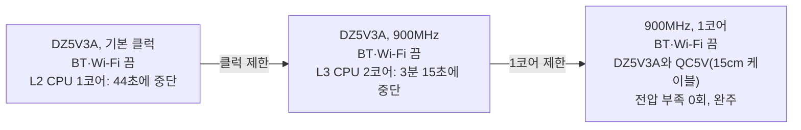

# RPi 전원(전압 부족) 시험 결과

## 시험 개요

- 시험일: 2026-11-09
- 장비: Raspberry Pi 3 B+, Debian 13, 32GB uSD, 유선 이더넷
- 측정 방법: `vcgencmd get_throttled` 의 "지금 전압 부족" 비트(bit 0)를 주기적으로 읽음
- 측정 한계: RPi에 입력 전압 센서가 없어 실제 전압값이 아니라 약 4.63V 미만 여부만 확인 가능
- 확인 간격: 90초 대기 시험은 1초 간격, 단계별 부하 시험은 약 2초 간격
- 전원 어댑터 명칭: **QC5V**(원래 쓰던 어댑터), **DZ5V3A**(교체한 어댑터, 케이블 일체형, 약 50cm)
- 전원 측정기 값(QC5V 사용 시, 전원 쪽): 4.97~5.00V, 최대 0.8A

## 요약

- 원인: 온도가 아니라 전원 경로(어댑터, 커넥터, 보드)로 판단. 시험 전체의 최고 온도는 53°C
- 설정으로 낮출 수 있었던 범위: BT·Wi-Fi를 끄고 900MHz로 제한하면 대기와 CPU 1코어에서 전압 부족 0%
- 한계: 900MHz에서도 CPU 2코어에서는 전압 부족이 다시 나타나 시험 중단
- 최종 운영 설정: BT·Wi-Fi 끔, 900MHz, 1코어(`maxcpus=1`)
- 최종 설정 결과: CPU 1코어와 uSD 쓰기를 동시에 걸어도 DZ5V3A와 QC5V(15cm 케이블) 모두 약 12분 동안 전압 부족 0회

## 1. 조건을 바꿔 가며 확인한 대기 상태

| 순서 | 조건 | 시험 | 표본 | 전압 부족 | 비율 | 비고 |
|---|---|---|---|---|---|---|
| 1 | QC5V + 50cm 케이블 | 대기 관찰 | - | - | 구간별 33~100% | 원본 로그 없음, 당시 관찰값 |
| 2 | QC5V + 15cm 케이블 | 대기 90초 | 90 | 9 | 10% | 9회 모두 처음 15초 안에 발생 |
| 3 | QC5V + 15cm 케이블 | L1 대기 | 70 | 13 | 18% | 10회 시작, 2분 21초에 자동 중단 |
| 4 | DZ5V3A | 대기 90초 | 90 | 4 | 4% | |
| 5 | DZ5V3A + BT·Wi-Fi 끔 | 대기 90초 | 90 | 1 | 1% | 첫 15초에 1회 |

## 2. 단계별 부하 시험

- 자동 중단 조건(하나라도 해당하면 중단)
  - 최근 60초 중 절반 이상 전압 부족
  - 한 단계에서 전압 부족 10회 이상 시작
  - 온도 80°C 이상
- 칸의 값 순서: 전압 부족 비율, 전압 부족이 새로 시작된 횟수

| 단계 | 부하 | 계획 시간 | DZ5V3A, 기본 클럭 (BT·Wi-Fi 끔) | DZ5V3A, 900MHz (BT·Wi-Fi 끔) | 900MHz 최고 온도 |
|---|---|---|---|---|---|
| L1 | 대기 | 3분 | 12% (11/89), 7회, 완주 | **0% (0/89), 0회, 완주** | 45°C |
| L2 | CPU 1코어 | 4분 | 52% (12/23), 10회, **44초에 중단** | **0% (0/118), 0회, 완주** | 49°C |
| L3 | CPU 2코어 | 5분 | 진행 못 함 | 16% (16/97), 10회, **3분 15초에 중단** | 53°C |
| L4 | CPU 3코어 | 6분 | 진행 못 함 | 진행 못 함 | - |
| L5 | CPU 4코어 | 6분 | 진행 못 함 | 진행 못 함 | - |
| L6 | CPU 4코어 + uSD 쓰기 | 6분 | 진행 못 함 | 진행 못 함 | - |

- 기본 클럭 시험의 최고 온도: 48°C
- 900MHz L3: 전압 부족이 약 20초 간격으로 4~6초씩 반복, 원인 미확인
- 스로틀링: 전압 부족과 같은 표본에서만 검출
- 최저 클럭: 모든 단계에서 600MHz로 기록됐으나 평상시 대기 클럭과 같아 판단 기준에서 제외

## 3. 900MHz + 1코어(`maxcpus=1`) 시험

### DZ5V3A

- 조건: DZ5V3A, BT·Wi-Fi 끔
- 시험 시각: 2026-11-10 00:00:38 ~ 00:12:41
- 결과: 완주

| 단계 | 부하 | 계획 시간 | 표본 | 전압 부족 | 시작 횟수 | 최고 온도 | 결과 |
|---|---|---|---|---|---|---|---|
| L1 | 대기 | 2분 | 59 | 0 (0%) | 0회 | 46°C | 완주 |
| L2 | CPU 1코어 | 3분 | 87 | 0 (0%) | 0회 | 48°C | 완주 |
| L3 | uSD 쓰기 (8MB씩 약 1초 간격) | 3분 | 88 | 0 (0%) | 0회 | 48°C | 완주 |
| L4 | CPU 1코어 + uSD 쓰기 | 4분 | 116 | 0 (0%) | 0회 | 50°C | 완주 |

- 시험 종료 시 `get_throttled` 값: `0x0`. 부팅 후 약 14분 동안 전압 부족과 스로틀링 기록 없음(이번 시험에서 처음 나온 결과)
- 커널 로그의 전압 부족 이벤트: 0건
- 확인한 시간: 약 12분. 장시간 안정성은 실제 운영 중 `get_throttled` 값으로 계속 확인 필요

### QC5V + 15cm 케이블

- 조건: QC5V, 15cm 케이블, 900MHz, 1코어, BT·Wi-Fi 끔
- 시험 시각: 2026-11-10 00:38:38 ~ 00:50:41
- 결과: 완주

| 단계 | 부하 | 계획 시간 | 표본 | 전압 부족 | 시작 횟수 | 최고 온도 | 결과 |
|---|---|---|---|---|---|---|---|
| L1 | 대기 | 2분 | 59 | 0 (0%) | 0회 | 46°C | 완주 |
| L2 | CPU 1코어 | 3분 | 87 | 0 (0%) | 0회 | 51°C | 완주 |
| L3 | uSD 쓰기 (8MB씩 약 1초 간격) | 3분 | 88 | 0 (0%) | 0회 | 51°C | 완주 |
| L4 | CPU 1코어 + uSD 쓰기 | 4분 | 116 | 0 (0%) | 0회 | 54°C | 완주 |

- 시험 종료 시 `get_throttled` 값: `0x0`
- 커널 로그의 전압 부족 이벤트: 0건
- 어댑터 비교: 900MHz·1코어에서는 QC5V와 DZ5V3A 모두 전압 부족이 없어, 이 시험으로는 두 어댑터의 차이 구분 불가

## 4. 현재 설정과 되돌리는 방법

| 항목 | 위치 | 설정 | 되돌리는 방법 | 백업 |
|---|---|---|---|---|
| Bluetooth 끔 | `/boot/firmware/config.txt` | `dtoverlay=disable-bt` | 줄 삭제 | `config.txt.bak-radio` |
| Wi-Fi 끔 | `/boot/firmware/config.txt` | `dtoverlay=disable-wifi` | 줄 삭제 | `config.txt.bak-radio` |
| 클럭 제한 | `/boot/firmware/config.txt` | `arm_freq=900` | 줄 삭제 | `config.txt.bak-clock` |
| 1코어 | `/boot/firmware/cmdline.txt` | `maxcpus=1` | 옵션 삭제 (파일은 한 줄 유지) | `cmdline.txt.bak-singlecore` |

- 변경 후 재부팅 필요

## 5. 전압 부족을 근본적으로 없애려면

- 일체형 케이블의 5.1V Raspberry Pi 정품 어댑터 사용, 앵글 커넥터와 측정기를 빼고 연결
- 멀티미터로 GPIO 2번(5V)과 6번(GND) 핀을 측정해 보드에 실제로 들어오는 전압 확인
